<div align="center">


<h1>Madhura</h1>

<p><strong>Plan the hour. Stay with it.</strong></p>

<p>A calm, intentional focus companion for your desktop.<br>
Decide what the next block of time is for, then let Madhura quietly help you stay with it.</p>

<p>
<a href="https://github.com/snehccurry/Madhura/actions/workflows/ci.yml"></a>
<a href="LICENSE"></a>


</p>

<p>
<a href="https://github.com/snehccurry/Madhura/releases/latest"><strong>Download for Windows</strong></a> ·
<a href="#features">Features</a> ·
<a href="#download--install">Install</a> ·
<a href="#keyboard-shortcuts">Shortcuts</a> ·
<a href="CHANGELOG.md">Changelog</a>
</p>

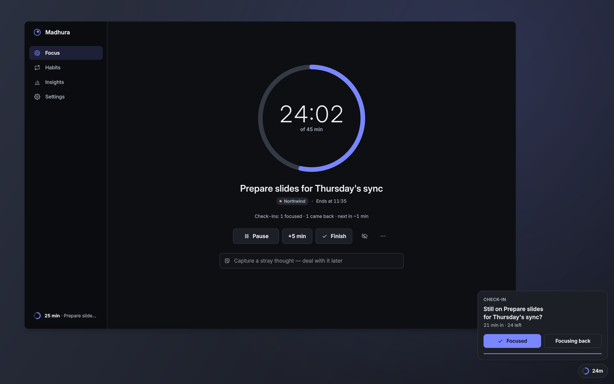

</div>

## Why Madhura

An hour slips away easily when nobody decided what it was for. Madhura makes you decide.
Before you start, you name **one thing** and pick a length: an hour by default, so the heading
reads *"Plan your next hour"*. Press **Lock in** and the window gets out of your way, shrinking to
a small floating timer at the edge of your screen. About **every 7 minutes** a quiet check-in
asks whether you're still on it: **Focused** or **Focusing back**. Saying "Focusing back" isn't a
failure. It counts as coming back, because noticing is the skill.

Between blocks, during your work hours, Madhura **nudges you to plan the next one**. Gently, with
a small panel, or firmly, by bringing its window forward, so the day never drifts without a
plan. And a habits page built on *Atomic Habits*, *"Improve by 1% every day — by the end of the
year, you'll reach ~37x growth"*, keeps the small daily things moving.

Madhura is built on a few promises:

- **It never steals your keyboard.** Panels appear without taking focus, so you never type into the wrong window.
- **Honest time.** Only time you actually focused counts. Paused time, sleep and time away from the computer never do.
- **Motivation without guilt.** Attainable defaults, forgiving streaks, no red grades.
- **Quiet by default.** Fewer, smarter interruptions, and silence while you present.
- **Your data stays on your computer.** No account, no cloud, no telemetry.

Madhura 2.0 is a complete rebuild of the original app. See [what changed](CHANGELOG.md).

## Features

### Focus & planning

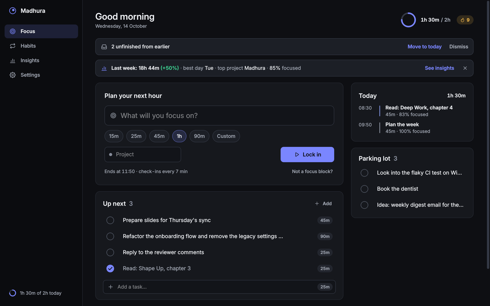

- **Plan one block.** Name the task, pick 15m · 25m · 45m · 1h · 90m or a custom length (5–240 min) and optionally a project. The caption previews the block, e.g. *"Ends at 11:50 · check-ins every 7 min"*. Task and project names autocomplete from your history.
- **Lock in** with the button, <kbd>Enter</kbd> or <kbd>Ctrl</kbd>+<kbd>Enter</kbd>. By default the window then hides to the mini timer; set *After Lock in* to *Stay open* if you prefer to keep it in view.
- **Up next** is today's short plan. Check items off, start one with a click, reorder with <kbd>Alt</kbd>+<kbd>↑</kbd>/<kbd>↓</kbd> or move it to tomorrow. Unfinished items from earlier days can be carried over in one click. When a block ends, the next item is already filled in.
- **Today** lists every block you've finished with its focus score. The header shows a goal ring for your daily goal (2 h by default) and your day streak.
- **Parking lot.** A stray thought mid-session? Press <kbd>C</kbd>, type it, and get back to work. Later, turn it into a task or clear it.
- **Not a focus block?** Start a labelled *Break*, *Lunch*, *Meeting* or *Admin* block (15–60 min) so that time is accounted for too.
- **During a session:** a ring counting down, the task and its project, the end time and a running check-in tally. Pause (<kbd>Space</kbd>), add 5 minutes, finish early (<kbd>Ctrl</kbd>+<kbd>Shift</kbd>+<kbd>F</kbd>), hide to the mini timer (<kbd>Ctrl</kbd>+<kbd>H</kbd>) or abandon it.
- **When a block ends** a short summary shows how many check-ins you were focused for. Add a note, mark the Up next task done, then *Keep going +15* or *Take a 5-min break* (5, 10 or 15 min). If the window is hidden, a small panel appears instead and the summary waits until you come back.

<p align="center">
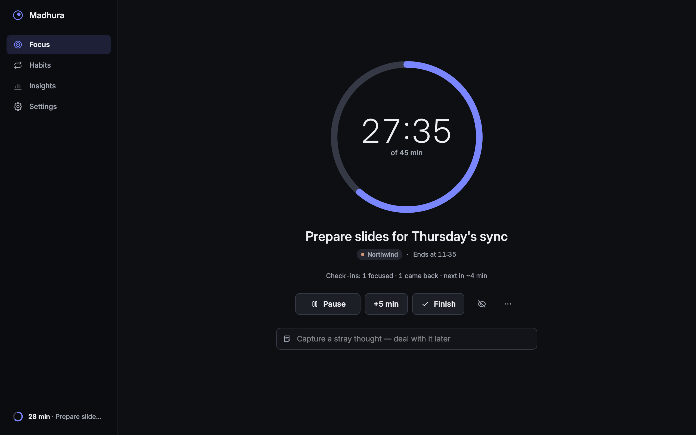
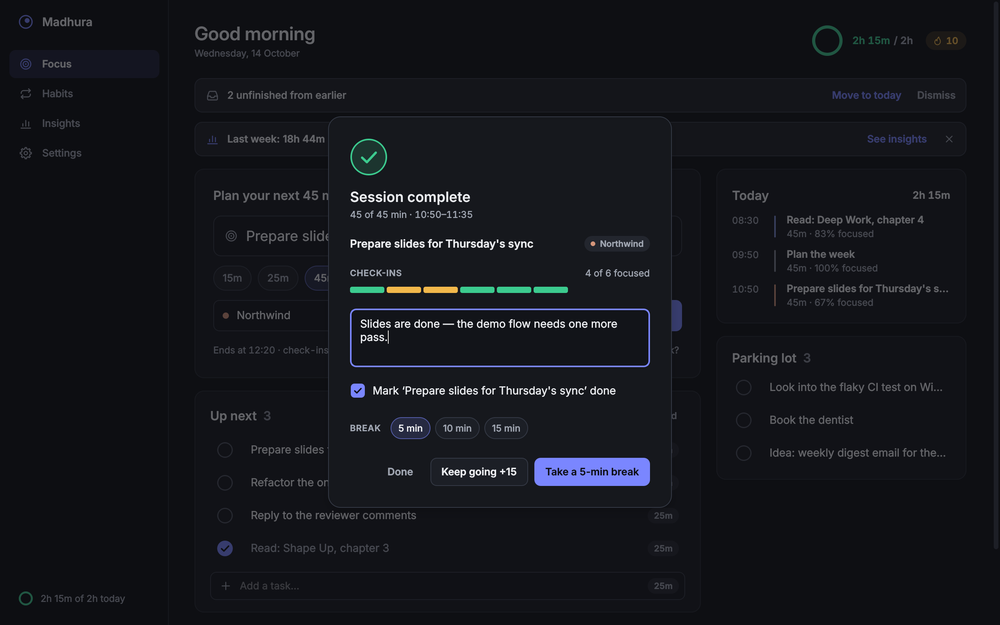
</p>

### Check-ins & the mini timer

<p align="center">
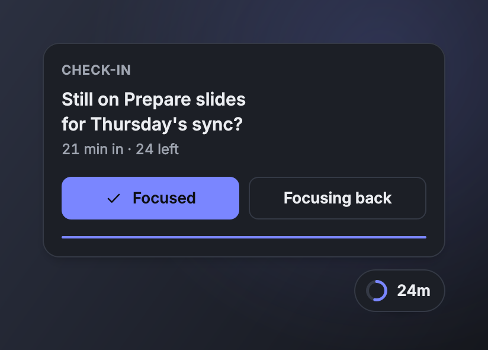
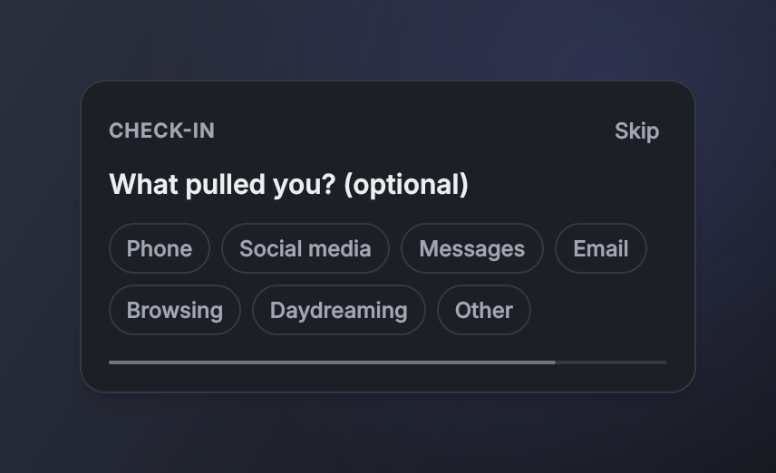
</p>

- **"Still on it?"** every 7 minutes of *focused* time (choose 5–30 in Settings). When Madhura's Focus page is in front, the question appears inline (answer with <kbd>F</kbd> or <kbd>B</kbd>). Otherwise a small panel slides in at the bottom-right of your screen without taking keyboard focus.
- **"Focusing back"** optionally asks what pulled you away: Phone, Social media, Messages, Email, Browsing, Daydreaming or Other. Insights later shows your most common pulls.
- **Adaptive spacing.** After 3 focused answers in a row the next check-in comes 1.5× later, after 6 in a row 2× later. A drift or a miss resets it.
- **Honest scoring.** A check-in left unanswered for a minute counts as *missed*: not focused, and left out of the score. Two misses in a row pause the session from the first one (*"Paused · were you away?"*).
- **Respectful timing.** No check-in in a session's last minute. Check-ins wait while you present or run a full-screen app (Windows) and during *Quiet for 1 hour* (tray menu), and at most one is shown when you're back. On Windows and macOS, after 5+ minutes away from the keyboard Madhura asks whether to keep or remove that time.
- **The mini timer** floats above your windows and shows the minutes left. Hover to expand it (time, task, pause and open), drag it anywhere (it snaps to screen edges and remembers its spot per monitor), double-click to open Madhura, right-click for a menu. It appears when the main window is hidden; set it to *Always* or *Never* in Settings.

<p align="center">
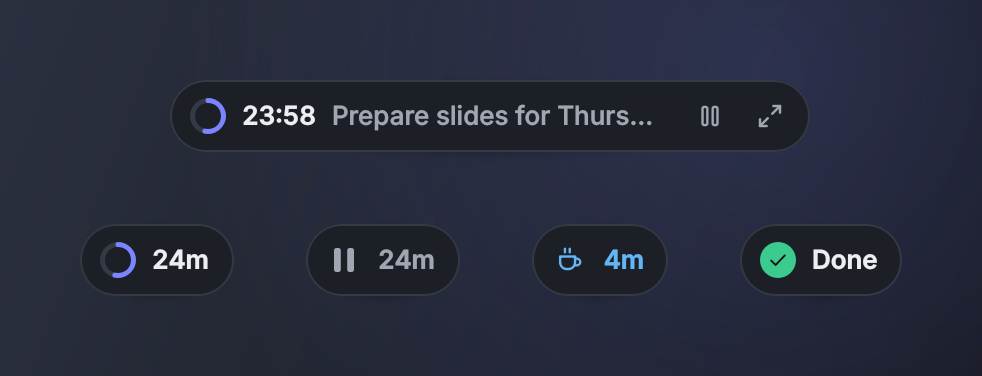
</p>

### Planning nudges

<p align="center">
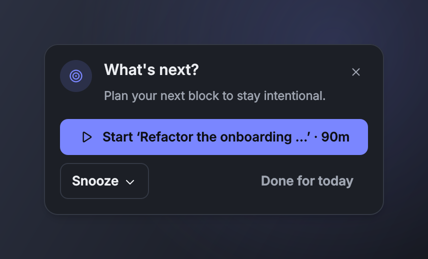
</p>

- When you're between blocks during your work hours (Mon–Fri, 09:00–18:00 by default) and a few idle minutes have passed (5 by default), Madhura asks **"What's next?"**
- **One click to start.** The nudge offers your first Up next task, continuing your last task (if it ended less than 2 hours ago), or *Plan now*.
- **Snooze** for 15 min, 30 min or 1 hour, or choose *In a meeting…*, which starts a 30- or 60-minute Meeting block. *Done for today* stops nudges until tomorrow.
- **Choose how firm.** *Gentle* (default) is a small panel that hides itself after 30 seconds. *Firm* brings the Madhura window forward with a banner (the original "plan before you continue" behavior), but never steals the keyboard. *Off* turns nudges off.
- A session paused for 20+ minutes gets a nudge too (*"Still paused on …"*). After work hours, Madhura offers once to **wrap up your day**.

### Habits

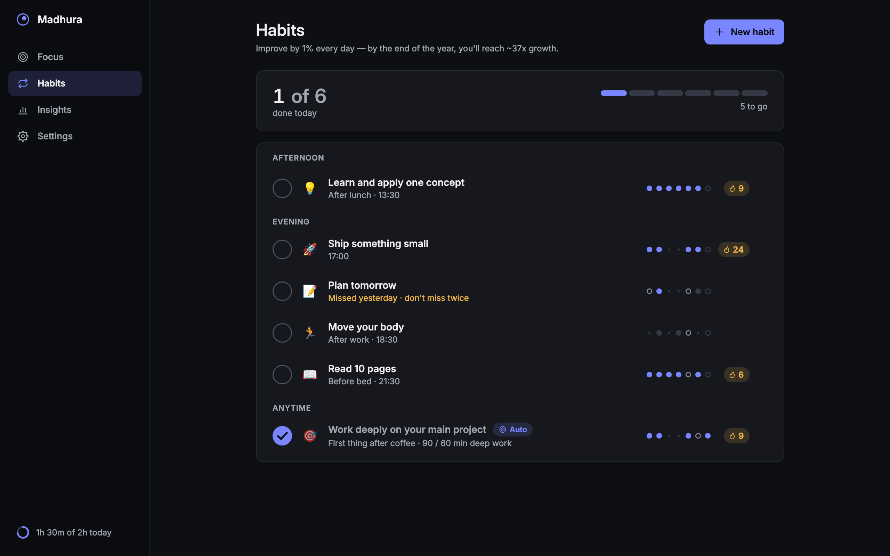

- **Small habits, big results.** Each habit has an optional emoji, a cue (*"After morning coffee"*), a time or *anytime*, and the days it repeats. The page groups them into Morning, Afternoon, Evening and Anytime. Habits not due today sit in a collapsed *Not today* list.
- **Forgiving streaks.** Check a habit off, or *skip today*, which never breaks a streak. Each row shows the last 7 days and your current streak. A habit missed yesterday reads *"Missed yesterday · don't miss twice"*, a nudge rather than a red mark.
- **Reminders at the right moment.** At a habit's time a small panel offers Done, Snooze 15m or Skip today. During a focus block, reminders wait and arrive together when the block ends, unless you mark a habit *urgent*.
- **Habits that complete themselves.** Turn on *Count focus time* and a habit like *"Work deeply on your main project"* is checked off automatically after 60 focused minutes, optionally counting only one project.
- **Suggestions to start from:** Work deeply on your main project · Ship something small · Learn and apply one concept · Read 10 pages · Move your body · Plan tomorrow.

<p align="center">
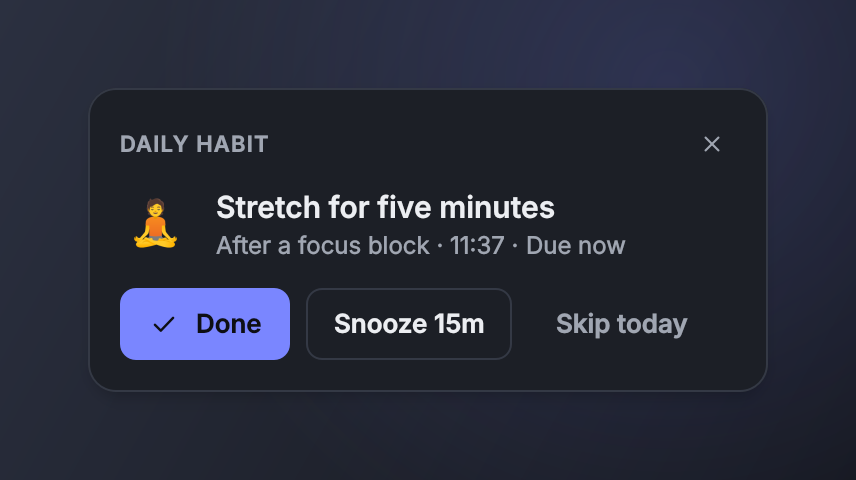
</p>

### Insights

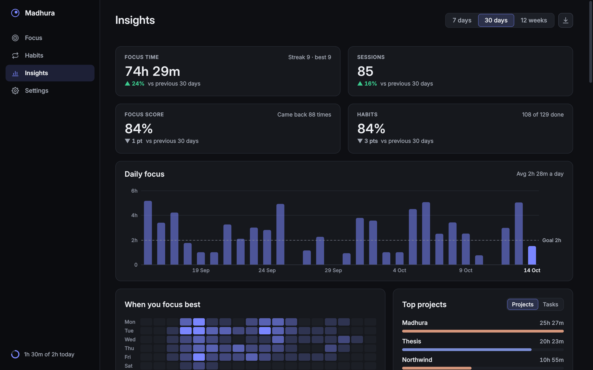

- **7 days · 30 days · 12 weeks** of focus time, sessions, focus score and habit completion, each compared with the previous period. A drop shows as a neutral ▼, never in red.
- A daily (or weekly) **bar chart** with your goal line. Hover a bar for details.
- **When you focus best**: a weekday × hour heatmap of your focused time.
- **Top projects and tasks**, **what pulls you away** (your drift reasons, plus how often you came back) and **recent sessions** with their notes. Delete a session with undo.
- **Export sessions as CSV** from the download button.
- Only real focus counts: totals include the focused time of completed and ended-early blocks. Paused, away and abandoned time never counts.

### Daily wrap-up & weekly recap

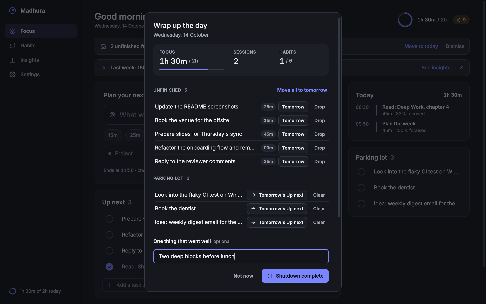

- **Wrap up the day** from the Focus page, the tray menu, or the prompt after work hours. See today's focus against your goal, sessions and habits. Then:
  - move unfinished tasks to the next work day, or drop them;
  - turn parking-lot notes into tomorrow's tasks;
  - write down one thing that went well;
  - set **tomorrow's first block**. The next morning's first nudge reads *"Good morning — your first block: …"*.
- **Shutdown complete** ends the day's nudges.
- **Weekly recap.** The first time you open Madhura in a new week, a card sums up the last one, e.g. *"Last week: 18h 44m (+50%) · best day Tue · top project Madhura · 85% focused"*.

### Settings, themes & accessibility

<p align="center">
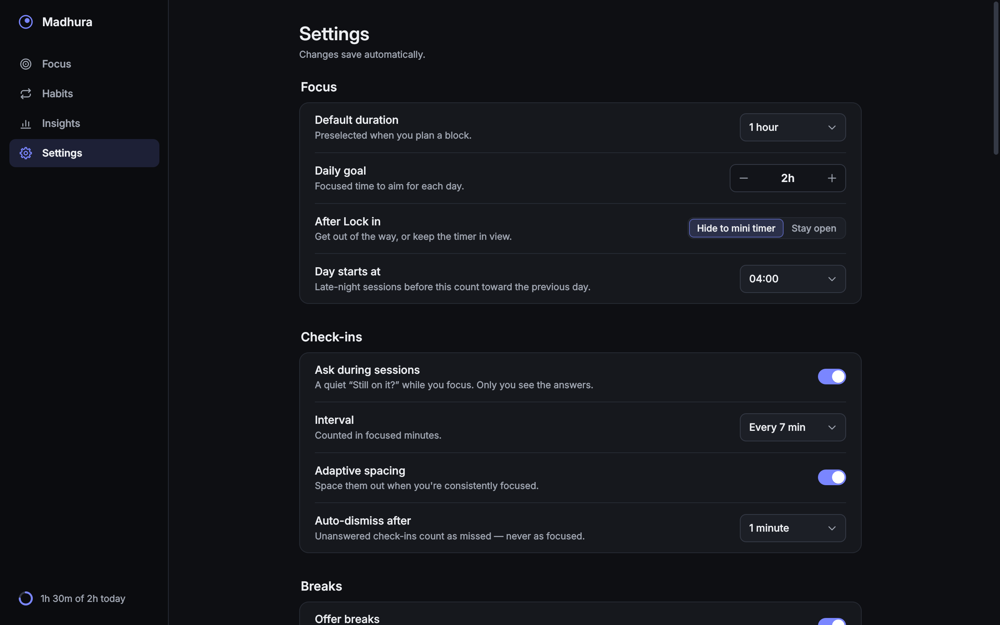
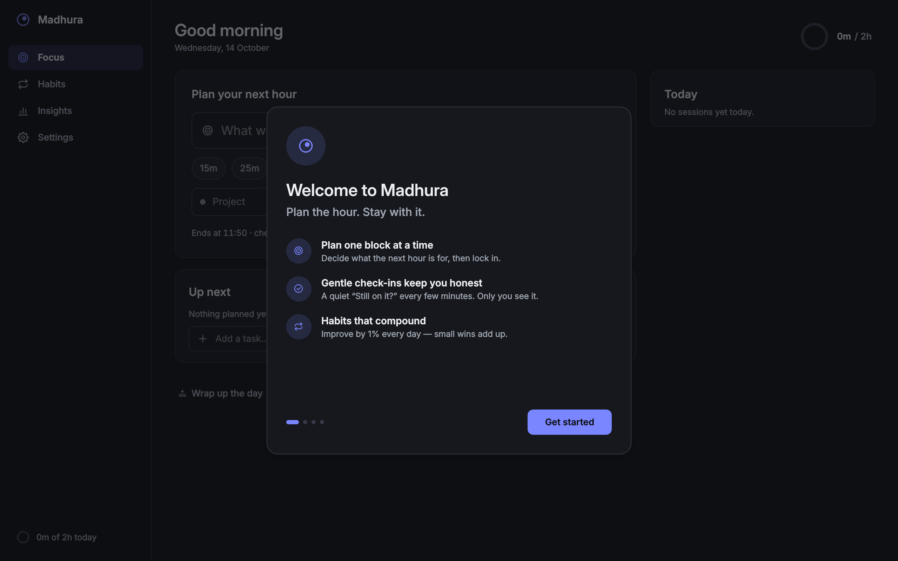
</p>

- **Every setting applies instantly.** Settings are grouped into Focus, Check-ins, Breaks, Accountability (nudge mode, work days and hours), Mini timer, Sound, Appearance, System, Data and About.
- **A guided first run** in four short steps: welcome, your day (daily goal, work days and hours, launch at login), accountability style, and your first block.
- **Dark, light or follow the system**, with five accent colors (Indigo, Teal, Rose, Amber, Violet) and 24- or 12-hour time.
- **Reduce motion** turns animations off. On first run it follows Windows' animation setting.
- **Keyboard first.** Every action has a shortcut (press <kbd>?</kbd>), focus rings show only for keyboard use, and icon buttons and charts have accessible names and descriptions.
- **One soft chime** with volume and per-event switches (check-ins, session complete, break over, habit reminders, nudges). It stays silent while you present and in quiet mode.
- **Your day can end late.** With *Day starts at* 04:00 (the default), a session at 01:30 still counts toward the previous day.
- **System tray.** The icon shows the session's progress, and the menu has Start focus…, Pause, +5 min, Finish, show or hide the mini timer, *Quiet for 1 hour*, *Snooze nudges 30 min* and *Wrap up the day…*. Closing the window keeps Madhura running in the tray, and it can start at login (Windows and Linux).

<p align="center">
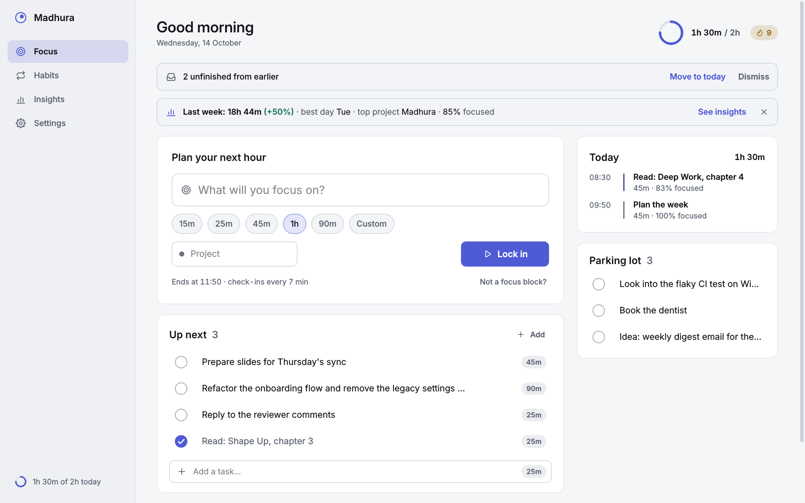
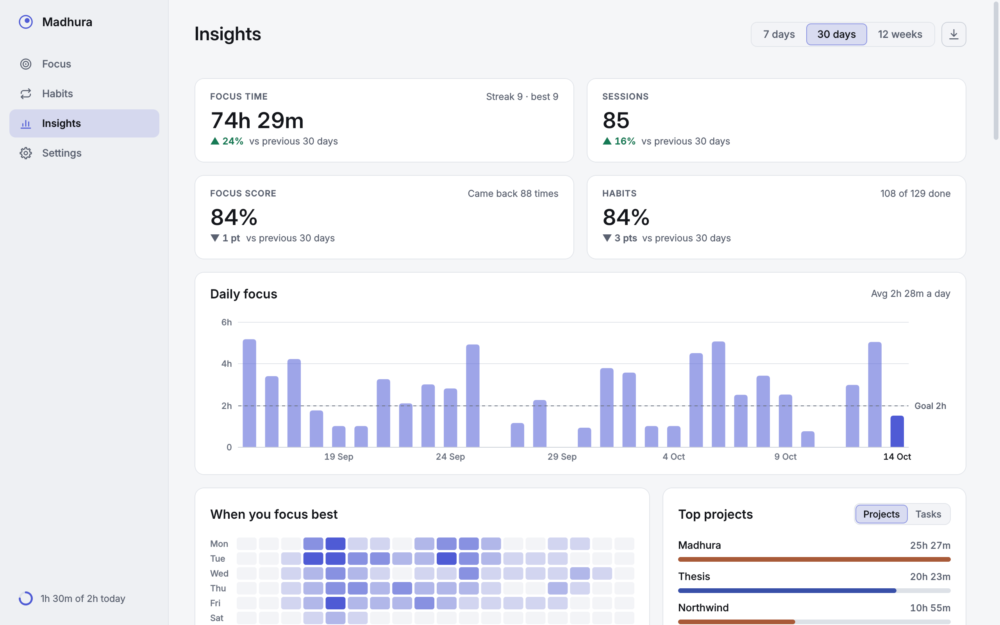
</p>

## How a day with Madhura looks

1. **Morning.** Madhura starts with your computer, quietly in the tray. The first nudge offers the block you planned last night: *"Good morning — your first block: Write the release announcement"*. One click and you're in.
2. **Lock in.** The window steps aside and the mini timer counts down in the corner.
3. **Stay with it.** Every 7 minutes or so, *Still on it?* → **Focused**. Caught yourself on your phone? **Focusing back**, and you're back. Stray thoughts go to the parking lot.
4. **The block ends.** A soft chime and a short summary, then a 5-minute break. When the break is over, the next Up next task is already filled in.
5. **Between blocks.** If you haven't planned the next block after 5 minutes, Madhura asks *What's next?*
6. **Habits fit around your blocks.** Reminders wait until the current block ends, and *Work deeply on your main project* checks itself off after an hour of focus.
7. **Evening.** *Wrap up your day?* Move leftovers to tomorrow, note one thing that went well, set tomorrow's first block, then **Shutdown complete**.
8. **Each week.** A recap of the week, and Insights shows when you focus best.

## Download & install

### Windows

1. Download **`Madhura-<version>-windows-x64.zip`** from the [latest release](https://github.com/snehccurry/Madhura/releases/latest).
2. Unzip it anywhere you like (for example `%LOCALAPPDATA%\Programs\Madhura`). Keep the folder together.
3. Run **`Madhura.exe`**. The build isn't code-signed, so Windows SmartScreen may warn the first time. Choose *More info → Run anyway*.
4. Optional: turn on **Settings → System → Launch at login**, or leave it on during the first-run setup. Madhura then starts quietly in the tray when you sign in. If you later move the folder, Settings offers to repair the entry.

Windows 10 or 11, 64-bit. To uninstall, turn off *Launch at login*, quit Madhura from the tray and delete the folder. Your data is kept in `%LOCALAPPDATA%\Madhura` (see [Your data](#your-data)).

### From source (Windows, Linux, macOS)

Requires Python 3.10 or newer.

```bash
git clone https://github.com/snehccurry/Madhura.git
cd Madhura
python -m pip install -r requirements.txt
python -m madhura
```

Or install it as a package, which adds a `madhura` command:

```bash
python -m pip install .
madhura
```

Command-line options: `--minimized` starts in the tray, `--version` prints the version.
`--autostart` is what *Launch at login* uses.

- **Linux:** the tray and *Launch at login* (an XDG autostart entry) need a desktop with a system tray. On GNOME that means the AppIndicator extension. Under Wayland, Madhura prefers XWayland (`xcb`) when it's available, because the tray, window raising and positioning work better there, and falls back to native Wayland. Qt's `xcb` plugin needs `libxcb-cursor0`.
- **macOS:** runs from source. *Launch at login* and a packaged app aren't available yet, and presentation detection is Windows-only.

## Build the Windows app yourself

In PowerShell, from the repository folder:

```powershell
python -m pip install -r requirements-dev.txt
pyinstaller --noconfirm madhura.spec
Start-Process dist\Madhura\Madhura.exe -ArgumentList '--self-test','report.txt' -Wait
Get-Content report.txt
```

`madhura.spec` builds a windowed, one-folder app in `dist\Madhura\` (`Madhura.exe` plus
`_internal\`) with the app icon and a version resource taken from `madhura/__init__.py` and
`LICENSE`. Zip the `dist\Madhura` folder to share it.

`--self-test [REPORT]` is a headless check that an install or build is complete. It imports
every module, checks the bundled assets (icon sizes, the chime), then builds the whole app on a
throwaway data folder: every page, the onboarding, shortcut and wrap-up sheets, and a focus
session that is started and abandoned. It exits with `0` when everything works and `1`
otherwise (add `-PassThru` to `Start-Process` to read `.ExitCode`), and never touches your data
or a running Madhura. `Madhura.exe` is a windowed program with no console, so the report goes to
the file you name. `python -m madhura --self-test` works for source installs too.

[CI](.github/workflows/ci.yml) builds and self-tests the app on every push to `main`. A tag
`vX.Y.Z`, which must match `__version__` in `madhura/__init__.py`, publishes the zip as a
GitHub release.

## Keyboard shortcuts

On macOS, <kbd>Ctrl</kbd> is <kbd>⌘</kbd>. Press <kbd>?</kbd> in Madhura for this list.

| Where | Keys | Action |
| --- | --- | --- |
| Anywhere | <kbd>Ctrl</kbd>+<kbd>1</kbd> · <kbd>2</kbd> · <kbd>3</kbd> | Focus · Habits · Insights |
| Anywhere | <kbd>Ctrl</kbd>+<kbd>,</kbd> (or <kbd>Ctrl</kbd>+<kbd>4</kbd>) | Settings |
| Anywhere | <kbd>Ctrl</kbd>+<kbd>N</kbd> | New task (focuses the plan field) · on Habits: new habit |
| Anywhere | <kbd>Ctrl</kbd>+<kbd>H</kbd> | Hide to the mini timer (during a session) |
| Anywhere | <kbd>Ctrl</kbd>+<kbd>Z</kbd> | Undo, while an undo toast is showing |
| Anywhere | <kbd>?</kbd> or <kbd>Ctrl</kbd>+<kbd>/</kbd> | Keyboard shortcuts |
| Anywhere | <kbd>Esc</kbd> | Close a popover or sheet, or leave a field |
| Anywhere | <kbd>Ctrl</kbd>+<kbd>Q</kbd> | Quit Madhura |
| Focus | <kbd>Enter</kbd> (in the plan field) or <kbd>Ctrl</kbd>+<kbd>Enter</kbd> | Lock in |
| Focus | <kbd>Space</kbd> | Pause · resume (when no text field has focus) |
| Focus | <kbd>Ctrl</kbd>+<kbd>Shift</kbd>+<kbd>F</kbd> | Finish the session |
| Focus | <kbd>C</kbd> | Capture a stray thought |
| Focus | <kbd>F</kbd> · <kbd>B</kbd> | Answer a check-in: Focused · Focusing back |
| Up next | <kbd>↑</kbd> <kbd>↓</kbd> · <kbd>Space</kbd> · <kbd>Enter</kbd> | Select · mark done · start it |
| Up next | <kbd>Alt</kbd>+<kbd>↑</kbd> <kbd>↓</kbd> · <kbd>F2</kbd> · <kbd>Del</kbd> | Reorder · edit · delete (with undo) |
| Habits | <kbd>↑</kbd> <kbd>↓</kbd> · <kbd>Space</kbd> · <kbd>S</kbd> | Select · mark done · skip today |
| Habits | <kbd>E</kbd> · <kbd>Del</kbd> | Edit · delete |
| Insights | <kbd>Del</kbd> | Delete the selected recent session (with undo) |
| Sheets | <kbd>Ctrl</kbd>+<kbd>Enter</kbd> | The sheet's main action (e.g. *Take a 5-min break*) |

## Your data

**Everything stays on your computer.** Madhura has no account and makes no network connections:
no cloud, no analytics, no telemetry, no update checks. Its only inter-process channel is a local
socket that lets a second launch bring the running window forward.

| OS | Data folder |
| --- | --- |
| Windows | `%LOCALAPPDATA%\Madhura` |
| macOS | `~/Library/Application Support/Madhura` |
| Linux | `$XDG_DATA_HOME/madhura` (usually `~/.local/share/madhura`) |

Set the `MADHURA_DATA_DIR` environment variable to keep the data somewhere else, for example
for a portable copy on a USB drive. Settings → Data → *Open folder* opens the folder. It holds:

- `madhura.db`: one SQLite database with your sessions, check-ins, tasks, habits and notes.
- `settings.json`: your preferences.
- `backups/`: **a copy of the database each day you use Madhura** (the newest 7 are kept), plus a copy before every import, reset or restore.
- `logs/`: a small rotating log, useful for bug reports.

**Export:** Settings → Data → *Export everything* writes all of it to one JSON file. Insights →
download button → *Export sessions (CSV)* gives you a spreadsheet of your sessions.

**Restore:** Settings → Data → *Restore from backup…* lists your backups (or choose any
Madhura `.db` file). Madhura restarts with it and keeps the database it replaced in `backups/`.

**Safety nets:** before a database upgrade Madhura saves the old file next to it
(`madhura.db.bak-v<N>`). If the database is ever damaged, it is set aside, renamed
`madhura.corrupt-<time>.db`, and a fresh one is started, and Madhura tells you once. *Reset all
data* (type `reset` to confirm) takes a backup first and keeps your settings.

## Upgrading from Madhura 1.x

Madhura 2.0 is a new app, rebuilt from scratch with a new design. It replaces the 1.x Tkinter app
([March 2026 releases](https://github.com/snehccurry/Madhura/releases)). It keeps its data in the
per-user folder above instead of next to the program. Your 1.x files are never modified.

- **Habits come with you.** On first run, Madhura looks for the 1.x `habits.json` in the current
  folder, next to `Madhura.exe`, and in your Desktop and Downloads folders (two levels deep). If
  it finds one, it offers *Import N habits from old Madhura*. You can also import later from
  Settings → Data → *Import old Madhura habits…*, which lists the files it found and offers
  *Choose file…*.
- **What's imported:** each habit's name and its time (`HH:MM`, otherwise *anytime*). Each
  habit repeats every day with reminders on. Habits you already have (same name) are skipped, so
  importing twice is safe, and a backup is taken first.
- **What isn't:** the 1.x "done today" flags and the 1.x session history
  (`madhura_sessions.json`). Your focus history starts fresh in 2.0.
- **Startup:** if you added 1.x to your Startup folder, remove that shortcut (press
  <kbd>Win</kbd>+<kbd>R</kbd>, run `shell:startup`) and use Settings → System → *Launch at login*
  instead.

## Development

```bash
python -m venv .venv
source .venv/bin/activate          # Windows: .venv\Scripts\activate
python -m pip install -r requirements-dev.txt
QT_QPA_PLATFORM=offscreen python -m pytest -q
```

The suite has about 1,400 tests (pytest + pytest-qt) and runs headless in about two minutes. In
PowerShell, set the platform with `$env:QT_QPA_PLATFORM = "offscreen"` first.

Handy tools:

- `python tools/screenshots.py --readme` regenerates the README images in `docs/screenshots/`. The
  output is deterministic: same demo data, clock and pixels every time.
- `python tools/screenshots.py` renders every screen and state, dark and light, into
  `build/screenshots/` for review (`--list`, `--only`, `--theme`, `--scale`).
- `python tools/seed_demo.py --data-dir /tmp/madhura-demo` seeds 8 weeks of realistic demo data.
  Then run `MADHURA_DATA_DIR=/tmp/madhura-demo python -m madhura`.
- `python tools/ui_gallery.py` renders the UI kit, every widget in its states, to PNGs.
- `python tools/make_assets.py` re-renders the app icon (`icon.png`, `icon.ico`, `icon.icns`).
- `python tools/check_docs.py` checks that the links, images, anchors and tables in these docs
  resolve.

Environment switches: `MADHURA_DATA_DIR` (data folder), `MADHURA_NO_SOUND=1`,
`MADHURA_NO_SINGLE_INSTANCE=1`, `MADHURA_FORCE_TRAY=0|1`.

```text
Madhura/
├── madhura/                 the application package
│   ├── app.py               startup, shutdown and command-line flags
│   ├── context.py           AppContext (shared services), AppEvents (signals)
│   ├── paths.py             data folder, bundled assets, environment switches
│   ├── log.py               log file, crash log, friendly error dialog
│   ├── selftest.py          --self-test: is this install or build complete?
│   ├── core/                pure logic: clock, logical day, models, analytics
│   ├── data/                SQLite repository, settings, backups, export, import
│   ├── services/            focus engine, check-ins, nudges, reminders, sound
│   ├── platform/            OS integration: idle, presentation, launch at login
│   ├── ui/                  design system, main window, sidebar, tray
│   │   ├── widgets/         UI kit: buttons, inputs, sheets, panels, charts
│   │   ├── pages/           Focus, Habits, Insights and Settings
│   │   └── overlays/        mini timer, panels, session summary, wrap-up
│   └── assets/              app icon and the notification chime
├── tests/                   pytest + pytest-qt suite, end-to-end flows
├── tools/                   screenshots, demo data, gallery, icon, docs check
├── docs/                    ARCHITECTURE.md and the README screenshots
├── packaging/entry.py       PyInstaller entry script
├── madhura.spec             PyInstaller build (one folder, windowed)
├── .github/workflows/       CI: tests, Windows build, releases
└── pyproject.toml           package metadata (pip install .)
```

How it fits together (layers, the focus engine's state machine, honest-time rules, the data
model, signals, theming, floating panels, testing and packaging) is in
**[docs/ARCHITECTURE.md](docs/ARCHITECTURE.md)**.

Issues and pull requests are welcome. Please run the test suite before opening a PR. For
visible changes, regenerate the README images with `python tools/screenshots.py --readme`.

## Roadmap

These are **ideas, not promises**. None of them exist in 2.0:

- **Optional sync** between your computers. Opt-in, keeping the local-first design.
- **Calendar integration**, so nudges and check-ins step aside during meetings and the day plan knows your free blocks.
- **A mobile companion** for checking off habits and seeing today's plan away from the desk.
- **A packaged macOS app** with launch at login (the `.icns` icon already exists).
- **A signed Windows installer** with an opt-in update notice.
- **Translations** of the interface.

Have another idea? [Open an issue](https://github.com/snehccurry/Madhura/issues).

## Credits & license

- Madhura was created by **Abhay Gaur**. Copyright © 2026 Федор Глеб | Abhay/Abhi Gaur. Released under the [MIT License](LICENSE).
- Notification sound: *"New Notification 041"* by **Universfield** via [Pixabay](https://pixabay.com/).
- Typeface on Linux and macOS: [Inter](https://rsms.me/inter/) by The Inter Project Authors, bundled under the [SIL Open Font License 1.1](madhura/assets/fonts/OFL.txt). Windows uses Segoe UI.
- Built with [Qt for Python (PySide6)](https://doc.qt.io/qtforpython-6/). The Windows build bundles Qt and PySide6, which are available under the LGPLv3.
- The habits page is inspired by James Clear's *Atomic Habits*.
