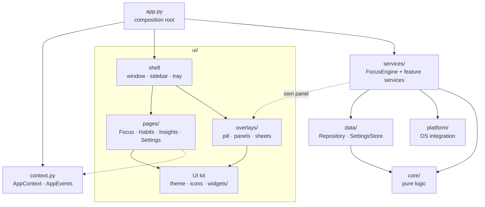
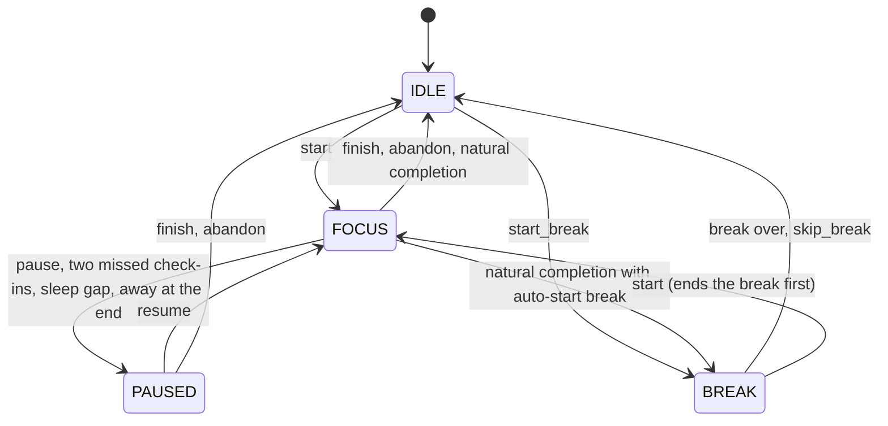

# Madhura architecture

A developer's guide to how Madhura 2.0 is put together: the layers, the focus engine and its
honest-time rules, the data model, who reacts to which signal, the logical day, the design
system, floating panels, tests and packaging. For using the app, see the [README](../README.md).

Madhura is a single-process PySide6 (Qt Widgets) desktop app for Python ≥ 3.10. Its only runtime
dependency is `PySide6-Essentials`. Windows comes first, and Linux and macOS work too.

## Ground rules

These hold everywhere in the codebase, and several are enforced by tests:

- **One wall clock.** Only `core/clock.py` reads the time (`SystemClock`). Everything else asks the
  injected `Clock` (`now()` → naive local `datetime`, `time()` → epoch seconds). Tests use
  `FakeClock`, and `tests/test_core_no_wallclock.py` greps the package for `datetime.now()`,
  `date.today()` and friends.
- **Durations are epoch math.** Elapsed time is always a difference of `clock.time()` values.
  Naive local datetimes are only for what gets stored or displayed (`"YYYY-MM-DDTHH:MM:SS"`).
- **No threads.** Everything runs on the Qt main thread, driven by `QTimer`s and signals.
- **Never steal focus.** Floating panels never activate. The window is raised without taking
  keyboard focus unless the user asked for it.
- **Platform code is guarded.** `madhura/platform/*` uses `ctypes` behind `sys.platform` checks
  and never raises. Unsupported features return `None` or `"available"`.
- **No raw dialogs.** UI code never calls `QMessageBox`/`QDialog.exec` directly. It goes through
  `ui/dialogs.py`, which uses an in-window sheet when there is one and tests monkeypatch.
- `from __future__ import annotations`, type hints and docstrings on public classes. No
  side effects at import time beyond definitions.

## Layers



Paths are relative to `madhura/`.

| Layer | Package | What lives there | May depend on |
| --- | --- | --- | --- |
| Pure logic | `core/` | `Clock`/`FakeClock`, logical-day math, dataclass models, `CheckInPlanner`, work-hours check, goal and habit streaks, habit scheduling, analytics aggregations, formatting | the standard library only (no Qt) |
| Data | `data/` | `Repository` (all SQL), `db.py` (connect, migrate, recover), `SettingsStore` (settings.json), backups, CSV/JSON export, 1.x habit import | `core`, `paths`; `QObject` for `SettingsStore` signals |
| Services | `services/` | the `FocusEngine` state machine and the long-lived behavior around it (check-ins, nudges, away detection, habit reminders, attention, sound, notifications, single instance) | `core`, `data`, `platform`, QtCore; feature services import their own overlay panel lazily |
| Platform | `platform/` | Windows/macOS/Linux integration: input idle time, presentation/full-screen state, launch at login, Win32 window helpers (topmost, flash, caption colors, AppUserModelID) | standard library (`ctypes`, `winreg`) |
| UI kit | `ui/theme.py`, `fonts.py`, `icons.py`, `animations.py`, `dialogs.py`, `ui/widgets/` | the design system and every reusable widget (buttons, chips, inputs, cards, list rows, banners, sheets, floating panels, popovers, toasts, charts) | PySide6 only (charts and the weekly recap card also use `core`) |
| Shell | `ui/main_window.py`, `sidebar.py`, `tray.py`, `shortcuts_sheet.py` | the window controller, navigation, tray, global shortcuts | everything above |
| Pages & overlays | `ui/pages/`, `ui/overlays/` | the four pages and every panel and sheet | `ctx`, the UI kit |

`app.py` is the only place that knows how everything is wired. Pages are imported lazily by
`MainWindow`. A page that fails to construct becomes a "This page couldn't load" empty state
rather than taking the app down, and each feature service is constructed inside its own
try/except, so one broken service only leaves its `ctx` attribute `None`.

### AppContext and AppEvents

`AppContext` (in `context.py`) is a dataclass passed to every page, overlay and feature service.
It holds `app`, `clock`, `repo`, `settings` (SettingsStore), `theme` (ThemeManager), `engine`,
`sound`, `notifier`, `events`, `attention`, `data_dir` and `tray_available`. The shell and the
services fill in `window`, `tray`, `checkins`, `nudges`, `habit_reminders`, `pill`, `away` and
`day_watcher`. Helpers: `ctx.today()` (the logical date), `ctx.day_bounds(d)`, `ctx.use_24h()`.

`AppEvents` carries the app-wide signals:

| Signal | Meaning |
| --- | --- |
| `data_changed(str)` | something was written: `"sessions"`, `"checkins"`, `"tasks"`, `"habits"`, `"captures"`, `"settings"` or `"all"` |
| `day_changed()` | the logical day rolled over (checked every 60 s, after `away_detected` and when *day starts at* changes) |
| `main_visibility_changed(bool)` | the main window became visible-and-not-minimized, or stopped being so |
| `navigate(str)` | show a page (`focus`, `habits`, `insights`, `settings`) |
| `toast(str, str)` | show a simple toast (text, kind) |

`WindowController` is the protocol the main window implements: `show_main(page, activate)`,
`hide_main()`, `is_main_visible()`, `is_main_active()`, `focus_task_input()`, `show_sheet()`,
`show_toast()`, `set_nudge_banner()`, `quit_app()` and a few more. Services talk to the window
only through it, and tests use `FakeWindowController`, which records the calls.

**Refresh rule:** receivers of `data_changed`/`day_changed` mark themselves dirty and refresh
when visible (`on_shown()` refreshes a dirty page), so a hidden page costs nothing.

### Startup and shutdown

`app.main()`:

1. Parse flags. `--self-test` runs `selftest.run()` and returns right away.
2. Set the Windows AppUserModelID. On Linux under Wayland, prefer XWayland (`QT_QPA_PLATFORM=xcb;wayland`).
3. **Single instance:** a `QLockFile` in the data folder is the authority. A second launch connects
   to the `QLocalServer`, sends `show` and exits 0.
4. Logging (rotating `logs/madhura.log`, `faulthandler` → `logs/crash.log`), then `QApplication`
   (Fusion style, `setQuitOnLastWindowClosed(False)`, app icon), fonts, the wheel guard and the excepthook.
5. `create_context()`: apply a staged restore, then load `SettingsStore`, open the `Repository`
   (migrate or recover), build the `ThemeManager`, engine, sound, notifier and attention monitor,
   and take the daily backup.
6. `create_main_window()`, the tray (when available), then `start_services()`: pill, check-ins,
   nudges, away, habit reminders, the `DayWatcher`, and finally **`engine.restore()`** once
   everything is connected.
7. Show the window, or stay in the tray for `--autostart`/`--minimized`/*start minimized* (minimized
   instead when there is no tray). `after_show()` then shows recovery notices, the onboarding
   sheet on first run and a pending session summary.

On quit (`aboutToQuit`, also `commitDataRequest`): flush settings, `engine.checkpoint()`, commit
pending undo-deletes, hide the tray, `PRAGMA wal_checkpoint(TRUNCATE)` and close the database.
Closing the window only hides it to the tray (`close_to_tray`). `quit_app()` pauses a running
focus session before quitting, so no time is credited while the app is closed.

## The focus engine

`services/engine.py` holds `FocusEngine`, the single source of truth for what is running.



Signals (all carry plain `str`/`int` values):

| Signal | When |
| --- | --- |
| `state_changed(str)` | after a transition, once the properties are consistent; only when (state, session) actually changed |
| `tick()` | when the whole-second display value changes (`remaining_whole_seconds` or the break's) |
| `session_started(int)` | a session row was created |
| `session_finished(int, str, bool)` | id, outcome (`completed`/`ended_early`/`abandoned`), `restored` (True when it ended while the app was closed) |
| `session_extended(int)` | seconds added by +5 min (total capped at 8 h) |
| `break_started(int)`, `break_finished(bool)` | break length; `True` = ran out naturally while the app was live |
| `away_detected(int)` | seconds away (sleep gap, restore gap, away at the end); the state is now PAUSED |

Commands: `start(task, minutes, project, planned_task_id)`, `pause(at=None)`, `resume()`,
`extend(minutes)`, `discard_focused(seconds)`, `finish()`, `abandon()`,
`start_break(minutes, label)`, `skip_break()`, `poll()`, `restore()`, `checkpoint()`.

### Honest-time rules

- **Focused time** = `focused_before + (now − segment_start)` while FOCUS, all in epoch seconds.
  Pausing closes the segment, and resuming opens a new one.
- **Timer:** a single-shot precise `QTimer` re-armed for the next whole-second boundary of the
  remaining time, plus 20 ms (at most 1 s). Each fire calls `poll()`. While PAUSED it only wakes for
  the heartbeat.
- **Sleep / suspend / freeze:** if `poll()` sees a gap of more than **90 s** while FOCUS, the segment
  is closed at the last poll, so only time up to there is credited. The engine goes to PAUSED and
  emits `away_detected(gap)`. A gap during a break that runs past the break's end finishes it
  silently (`break_finished(False)` → IDLE).
- **Clock set back:** a negative delta shifts the anchors by the same amount, so no negative or
  extra time is ever credited.
- **Away probe:** where input idle time is known (Windows, macOS), `AwayService` installs a probe
  returning when the user went idle. A session that reaches its end while the user is away pauses
  where they left instead of completing, and a sleep gap closes the segment at the start of the
  idle stretch. After 5+ idle minutes the AwayPanel offers to remove that time
  (`discard_focused`).
- **Missed check-ins:** two misses in a row call `engine.pause(at=<time of the first miss>)`, a
  retroactive pause clamped to the segment start.
- **Finishing:** less than 60 s focused → `abandoned` and the row is deleted ("Too short to save").
  Remaining ≤ 1 s → `completed`. Otherwise → `ended_early`. `abandon()` keeps the row (as
  `abandoned`) only if at least 60 s were focused.
- **Persistence:** every transition and a **30 s heartbeat** write a JSON snapshot (kv
  `engine_snapshot`, version 1: state, session id, task, planned seconds, `focused_before`,
  `segment_start`, pause and break anchors, `last_alive`) **and** the session row's
  `focused_seconds`/`paused_seconds` in one transaction (`repo.save_engine_checkpoint`).
- **Restore** (once at startup): `gap = now − last_alive`.
  - FOCUS whose focused-at-death already covers the plan → completed with `restored=True` (a toast, no sheet).
  - FOCUS with a gap ≤ **120 s** → resumes, and the gap counts (a quick restart).
  - FOCUS with a longer gap → PAUSED at `last_alive` with `away_detected(gap)`.
  - PAUSED stays paused.
  - A break resumes if it hasn't ended, otherwise IDLE silently.
  - An invalid snapshot or a missing row is discarded. Any other leftover `active` rows are
    closed as `ended_early` (or deleted under 60 s).
- **Natural completion order:** transaction (row ended, snapshot cleared or set to break) →
  internal state → `session_finished(id, 'completed', False)` → either `break_started` +
  `state_changed('break')` with no intermediate `'idle'`, or `state_changed('idle')`.
- **Re-entrancy:** every transition bumps a generation counter, and an emission sequence stops as
  soon as a slot started a new transition. So calling `start_break()` or `start()` from a
  `session_finished` handler is safe.

### Check-in timing

`core/checkins.py` `CheckInPlanner` is pure. The next check-in is due when *focused* seconds
reach `next_due`, never with less than 60 s left. The interval is the base (7 min by default),
×1.5 after 3 focused answers in a row and ×2 after 6 (with *adaptive* on). A drift or miss resets
the streak. `CheckInService` evaluates it on every `engine.tick`, so paused time never counts.
Due check-ins are deferred while attention is busy, quiet or away (re-tested every 15 s), stale
ones are dropped without a record, and none fire while input has been idle for 5+ minutes. The
focus score is `focused / (focused + drifted)`. Misses are shown separately, and the score is
`None` with no answers.

## Data model

One SQLite file, `madhura.db`, in the data folder (`paths.data_dir()`; `MADHURA_DATA_DIR`
overrides it). Connection: autocommit (`isolation_level=None`), `journal_mode=WAL` (falls back to
`DELETE`), `synchronous=NORMAL`, `foreign_keys=ON`, `busy_timeout=3000`. Multi-statement writes
use `repo.transaction()` (`BEGIN IMMEDIATE`; nested calls become savepoints). **All SQL lives in
`data/repository.py`**, and its methods return the dataclasses from `core/models.py`.

| Table | Columns (abridged) | Notes |
| --- | --- | --- |
| `sessions` | `task`, `project`, `planned_task_id`, `started_at`, `ended_at`, `planned_seconds`, `focused_seconds`, `paused_seconds`, `outcome`, `note` | outcome `active` · `completed` · `ended_early` · `abandoned` |
| `checkins` | `session_id` → sessions (cascade), `at`, `response`, `reason` | response `focused` · `drifted` · `missed`; reason is the chip label |
| `tasks` | `title`, `project`, `minutes`, `plan_date`, `position`, `done`, `created_at`, `completed_at` | Up next items, per logical date |
| `habits` | `name`, `emoji`, `cue`, `time`, `days` (Mon = bit 0 … Sun = bit 6), `reminder`, `urgent`, `focus_minutes`, `project`, `position`, `archived`, `created_at` | `focus_minutes` set = auto-complete habit |
| `habit_logs` | `habit_id` → habits (cascade), `date`, `status`, `at` | `done` · `skipped`; unique per habit and date |
| `captures` | `session_id` → sessions (set null), `text`, `at`, `done` | the parking lot |
| `day_notes` | `date` (PK), `note` | "one thing that went well" |
| `kv` | `key` (PK), `value` (JSON) | small app state, below |

Indexes: `sessions(started_at)`, `checkins(session_id)`, `checkins(at)`, `habit_logs(date)`,
`tasks(plan_date)`. Datetimes are stored as naive local ISO strings, dates as `YYYY-MM-DD`.

`kv` keys: `engine_snapshot`, `pending_complete`, `checkin_intro_seen`, `nudge_snooze_until`,
`nudge_done_date`, `nudge_last_date`, `wrap_up_prompt_date`, `quiet_until`, `habit_snoozes`,
`pill_pos`, `window_geometry`, `goal_toast_date`, `carryover_dismissed`, `weekly_recap_seen`,
`insights_range`, `tray_hint_shown`, `recovered_from`.

**Counting rule** (shared by totals, the goal ring, streaks, heatmap and projects): only the
`focused_seconds` of `completed` and `ended_early` sessions count. `abandoned` rows appear only
in *Recent sessions*, with a badge. `active` rows are never shown.

**Schema changes and safety:** `PRAGMA user_version` drives migrations (`data/db.py`,
`SCHEMA_VERSION = 1`). Before migrating an existing file it is copied to
`madhura.db.bak-v<old>` (the last 2 are kept). A file that fails to open or fails `quick_check`
is renamed `madhura.corrupt-<timestamp>.db`, a fresh database is created, and kv
`recovered_from` triggers a one-time notice. A locked or unreachable database is *not* treated
as damaged: the app shows an error instead of starting fresh.

**Backups** (`data/backup.py`): `daily_backup()` copies the database via `Connection.backup` to
`backups/madhura-YYYY-MM-DD.db` on the first start of each logical day and keeps the newest 7.
`backup_now()` takes tagged copies before imports and resets. *Restore* validates a chosen file,
stages it as `madhura.db.restore` and relaunches. At the next start, `apply_staged_restore()`
swaps it in before connecting and keeps the replaced database as
`backups/madhura-pre-restore-<timestamp>.db`.

**Settings** (`data/settings.py`): a dataclass with defaults, persisted as `settings.json`
(`schema_version: 1`). Validators are strict (`type(v) is bool/int`). On load, unknown keys are
dropped and invalid values fall back to defaults. A file that doesn't parse is renamed
`settings.json.bad`. `SettingsStore.update(**changes)` is all-or-nothing, emits `changed(key)`
per changed key and writes atomically after a 300 ms debounce (tmp + fsync + `os.replace`).
*Launch at login* is not a setting: its truth is the OS (`platform/autostart.py`: the Run
registry value plus the StartupApproved check on Windows, an XDG autostart file on Linux).

**Export** (`data/export.py`): sessions CSV (UTF-8 with BOM, logical date column, check-in counts
and score, guarded against CSV formula injection) and everything-JSON (`export_dict()` plus app,
version and export time).

## Signals and ownership

Each user-visible reaction has exactly one owner, so nothing happens twice. Signal names without a
prefix are `FocusEngine` signals:

| Event | Owner | Reaction |
| --- | --- | --- |
| `session_started`, `session_finished`, `session_extended` | `app.py` | `events.data_changed("sessions")` |
| `session_finished` | `FocusPage` | `present_session_complete()` in `overlays/session_complete.py`: the in-window summary sheet if the window is active, otherwise a `CompletionPanel` plus a pending sheet (kv `pending_complete`), a toast for restored or abandoned sessions; sound `complete` |
| `session_finished` | `HabitReminderService` | auto-complete focus habits, deliver reminders held during the session |
| `away_detected` | `FocusPage` | the away banner (*Resume · Finish · Abandon*); `app.py` also re-checks the logical day |
| `break_finished(True)` | `FocusPage` | sound `break_over`, a notification if hidden, the idle view with the next task filled in |
| `tick` | `CheckInService`, `AwayService`, `ActiveView`, pill, sidebar, tray | evaluate check-ins, sample idle time, repaint (each only when its text changes) |
| check-in fired / answered | `CheckInService` | inline prompt (`prompt_inline`) or `CheckInPopup`; records via `repo.add_checkin`, `data_changed("checkins")`, sound `checkin` |
| nudge due | `NudgeService` | `NudgePopup` (gentle) or `show_main(activate=False)` + the Focus page banner (firm); sound only if `sound_nudge` |
| habit due | `HabitReminderService` | `HabitReminderPopup`; `data_changed("habits")`, sound `habit` |
| tasks / captures written | whoever writes (Focus page, summary sheet, wrap-up) | `data_changed("tasks")` / `("captures")` |
| import / reset | Settings page | backup first, then `data_changed("all")` |
| settings key changed | `app.py` | applies theme/accent/motion and emits `data_changed("settings")` |
| `main_visibility_changed` | `MainWindow` emits it | the pill's visibility rule, the pending summary sheet |

`AttentionMonitor` (`services/attention.py`) combines quiet mode (tray: *Quiet for 1 hour*, kv
`quiet_until`), the OS state (Windows `SHQueryUserNotificationState`: presentation or
full-screen → `busy`, locked → `away`) and input idle into one state, with precedence
`quiet > away > busy > available`. It polls every 15 s (every 2 s while busy). Check-ins, nudges,
habit reminders, sound and the pill all consult it.

## The logical day

`day_start_hour` (default 4, range 0–6) defines when "today" begins:
`core.days.logical_date(dt, day_start_hour) = (dt − day_start_hour h).date()`. So a session
started at 01:30 belongs to the previous day. Everything "today" uses `ctx.today()` and
`ctx.day_bounds(d)`: the goal ring, streaks, the Today card, Up next `plan_date`, carry-over, habit
done-today and streaks, nudges' *done for today*, wrap-up and every analytics bucket. A session
belongs to the logical date of its `started_at`. The greeting is the one exception: it follows
the real clock. `DayWatcher` (in `app.py`) emits `day_changed` when `ctx.today()` changes (60 s
timer, after `away_detected`, on a *day starts at* change) and takes the daily backup.

Weekday masks use Mon = bit 0 … Sun = bit 6 (`127` every day, `31` Mon–Fri). Work hours
(`core.nudges.in_work_hours`): start = end means all day, and start > end wraps past midnight,
with the day mask applying to the start day.

## Design system and theming

- **`ui/theme.py`:** `Palette` is a frozen dataclass of color tokens (`bg`, `sidebar`, `surface`,
  `surface_alt`, `hover`, `border`, `border_strong`, `track`, `text`, `text_muted`,
  `text_subtle`, `success`, `warning`, `danger`, `break_`, `accent` and derived `accent_hover`,
  `accent_soft`, `accent_border`, …) for `dark` and `light`, with five accents (indigo, teal,
  rose, amber, violet; each has a dark and a light variant). `ThemeManager` resolves
  *system/dark/light* (following `colorSchemeChanged` for *system*), applies the QPalette and one
  generated stylesheet, and emits `changed()` only when the resolved palette changes.
- **Widgets read `theme.current().palette` when they paint**, so a theme switch needs no rebuild.
  Labels are styled through two dynamic properties, `role` (`display`, `h1`, `h2`, `body`,
  `label`, `caption`, `micro`, …) and `tone` (`muted`, `accent`, `success`, …), changed with
  `theme.set_prop()` (setProperty + re-polish).
- **Type and spacing:** display 60/300 · h1 24/600 · h2 16/600 · body 14 · label 13/600 ·
  caption 12 · micro 11/600 uppercase. Spacing on a 4/8 grid. Radii: card 12, control 8, popup 14,
  sheet 16, chips and pills fully round. Fonts (`ui/fonts.py`): Segoe UI Variable on Windows 11,
  Segoe UI on Windows 10, otherwise Inter, then the system font. Timers use tabular digits.
- **Icons** (`ui/icons.py`) are small stroke SVGs rendered by a `QIconEngine` at the device pixel
  ratio (crisp at 125–175 %), cached per (name, color, size, dpr) and cleared on theme change.
- **Motion** (`ui/animations.py`): 160–240 ms OutCubic. *Reduce motion* turns animations off or
  to opacity only. Temporary `QGraphicsEffect`s are always removed after an animation (never left
  on text).
- **Accessibility:** custom checkables are `QAbstractButton`s with accessible names, icon buttons
  have tooltips and names, the focus ring is painted only for keyboard focus, charts publish an
  accessible description, the minimum hit target is 32×32, and body text contrast is ≥ 4.5:1.
- Project colors come from a hash of the name onto 8 muted, theme-aware hues
  (`theme.project_color`), computed and never stored.

## Floating panels, sheets and the popup stack

Madhura has four kinds of surfaces, each with its own rules:

| Surface | Where | Rules |
| --- | --- | --- |
| **Sheet** (`widgets/sheet.py`) | inside the main window, over a dimmed backdrop | one at a time with a FIFO queue; traps Tab; <kbd>Esc</kbd> closes (unless not dismissible, like onboarding); <kbd>Ctrl</kbd>+<kbd>Enter</kbd> runs the primary button; page shortcuts are disabled while open |
| **Floating panel** (`widgets/popup.py`) | its own top-level window at the screen's bottom-right | check-in, nudge, away, habit reminder, completion panel and the pill |
| **Popover** (`widgets/popover.py`) | a small card anchored to a widget in the window | custom duration, emoji picker, … |
| **Toast** (`widgets/toast.py`) | bottom of the main window | one at a time; an *Undo* action also runs on <kbd>Ctrl</kbd>+<kbd>Z</kbd>; deletes commit when the toast expires |

`FloatingPanel` rules (the "never steal focus" promise):

- always **parentless**, kept alive by its controller;
- flags `Tool | FramelessWindowHint | WindowStaysOnTopHint | WindowDoesNotAcceptFocus`, with
  `WA_ShowWithoutActivating` and a translucent background;
- every child button has `NoFocus`, and a panel is never `activateWindow()`-ed or `raise_()`-d;
- on Windows, topmost is reasserted every 5 s while visible;
- a painted shadow from a cached, blurred 9-slice pixmap keyed by size and device pixel ratio;
- enters by sliding up 16 px and fading in (220 ms), exits by fading out (160 ms), opacity only with *reduce motion*;
- `set_content()` swaps content keeping the bottom edge fixed (the panel grows upward).

`PopupStack` (a singleton) places them:

- **Priorities**, bottom to top: completion 0 · check-in 1 · away 2 · habit 3 · nudge 4.
- At most **3 visible**; extras queue. A **nudge never shows alongside another panel**.
- **Target screen**: the pill's screen if it is visible, otherwise the screen under the cursor,
  otherwise the primary screen.
- **Layout**: anchored at the bottom-right of the available geometry with a 16 px margin and
  10 px gaps. The pill is the stack's *obstacle*: when it is in the column, the stack starts
  10 px above it.
- **Relayout** is animated (200 ms) on removal and when screens are added, removed or resized.
  The math is a pure function (`compute_layout`) with its own tests.

The **pill** (`overlays/pill.py`) is a `FloatingPanel` subclass. It shows whole minutes
(seconds in the last minute) and expands on hover. While dragging, hover expansion is
suppressed, and on release it snaps to an edge within 16 px. Its position is persisted per
screen as an offset from the bottom-right (kv `pill_pos`) and reset to the default corner if that
screen is gone. Its visibility is driven only by signals, with no polling: engine state ×
`pill_mode` × main-window visibility × the user's hide toggle × quiet mode.

## Testing

```bash
QT_QPA_PLATFORM=offscreen python -m pytest -q     # about 1,400 tests, about 2 minutes
```

- **pytest + pytest-qt on Qt's offscreen platform.** `tests/conftest.py` isolates every test: a
  temporary `MADHURA_DATA_DIR`, `MADHURA_NO_SINGLE_INSTANCE=1`, `MADHURA_NO_SOUND=1`, and fixtures
  `fake_clock` (Wed 2026-10-14 10:00), `repo`, `settings_store` and `engine`.
- **Time is simulated, never slept.** Tests move `FakeClock` forward and call `engine.poll()`
  themselves, in steps of at most 90 s, since a bigger jump is a "sleep". `FakeClock` with a
  `zoneinfo` zone models DST transitions exactly.
- **Pure logic is tested exhaustively** (`test_core_*`, `test_*_core_*`): logical days, streaks,
  the check-in planner, analytics, habit scheduling.
- **The engine** (`test_engine*.py`): sleep gaps, clock set back, restore with short and long
  gaps, emission order on auto-break, re-entrancy, finish under 60 s.
- **UI tests build the real thing**: `create_context` + `create_main_window` on a temp data dir,
  with `FakeWindowController` where a service is tested alone. They drive pages, sheets and panels
  through their public methods and widgets.
- **End-to-end journeys** (`test_e2e_flows.py`) drive the real window through whole flows: first
  run to the first block, a hidden-window session with panels and a break, nudges, habit
  reminders held during focus, a suspend gap, quitting or being killed mid-session and
  relaunching, a day rollover, the tray menu and wrap-up.
- **Guards:** no wall-clock reads outside `core/clock.py`; `selftest.MODULES` lists every module;
  the CI workflow's Windows test list names existing files; `make_assets.py` still reproduces the
  committed icons.
- File prefixes follow the area: `core`, `data`, `engine`, `services`, `ui_kit`, `shell`, `p1`
  (focus planning), `p2` (active session and summary), `o` (overlays, check-ins, nudges, pill),
  `h` (habits), `i` (insights, wrap-up), `s` (settings, onboarding, autostart), `d` (packaging), `e2e`.
- **Visual review:** `tools/screenshots.py` renders every screen and state deterministically
  (fixed clock and seed, demo data from `tools/seed_demo.py`), and `tools/ui_gallery.py` renders
  every widget. `--readme` refreshes the images in `docs/screenshots/`.

**CI** (`.github/workflows/ci.yml`) runs the full suite and `--self-test` on Linux with Python
3.10 and 3.13, plus a frozen-build smoke test on 3.13. On Windows (3.13) it runs the platform and
logic tests and the self-test. Widget-level tests run on Linux, where offscreen fonts and metrics
are stable.

## Packaging

- **PyInstaller** (`madhura.spec`): a windowed, one-folder build, `dist/Madhura/`. The
  entry script is `packaging/entry.py`, which lives outside the package because PyInstaller puts
  the script's folder on its search path, where `madhura/platform` would shadow the standard
  library's `platform`.
  - Bundles `collect_submodules("madhura")` (pages and services are imported lazily) and the
    whole `madhura/assets` tree.
  - Leaves out what Madhura never uses: Qt translations, the software OpenGL fallback, Qt PDF.
  - No UPX.
  - On Windows it writes the icon and a version resource (version from `madhura/__init__.py`,
    copyright from `LICENSE`).
- **Assets:** `paths.asset()` resolves against `sys._MEIPASS` when frozen. The icon files
  (`icon.png` 512 px, a multi-size `icon.ico` 16–256 px, `icon.icns`) are rendered by
  `tools/make_assets.py` with QPainter, each size drawn natively.
- **`--self-test [REPORT]`** (`madhura/selftest.py`) imports every module, checks the assets and
  SVG rendering, then builds the real app on a temporary data folder: every page, the
  onboarding, shortcuts and wrap-up sheets, and a focus session. It fails with exit code 1 on any
  import error, missing asset, page fallback, ERROR log, unhandled exception or Qt critical
  message. CI runs it on every build.
- **Releases:** pushes to `main`, `v*` tags and manual runs build `Madhura-<version>-windows-x64.zip`
  on Windows after both test jobs pass. A `vX.Y.Z` tag must match `__version__`, and it publishes
  the zip as a GitHub release.
- **Python package:** `pyproject.toml` (setuptools ≥ 77, SPDX `license = "MIT"`) installs the
  `madhura` GUI script; `pip install .` and `python -m madhura` both work.

To release: bump `__version__` in `madhura/__init__.py` and `version` in `pyproject.toml`, add a
section to `CHANGELOG.md`, then tag `vX.Y.Z` and push the tag.
